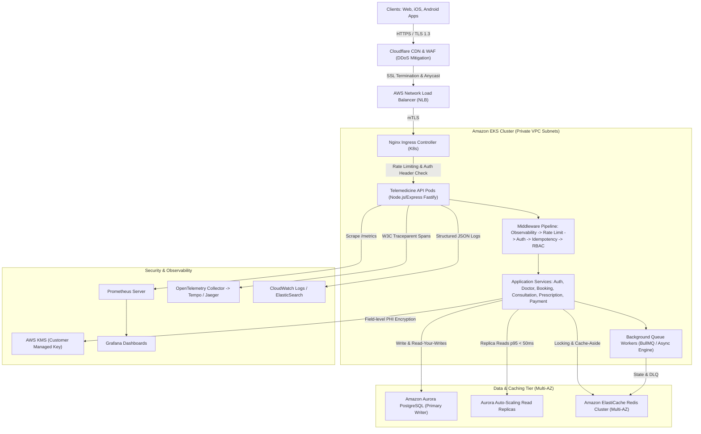
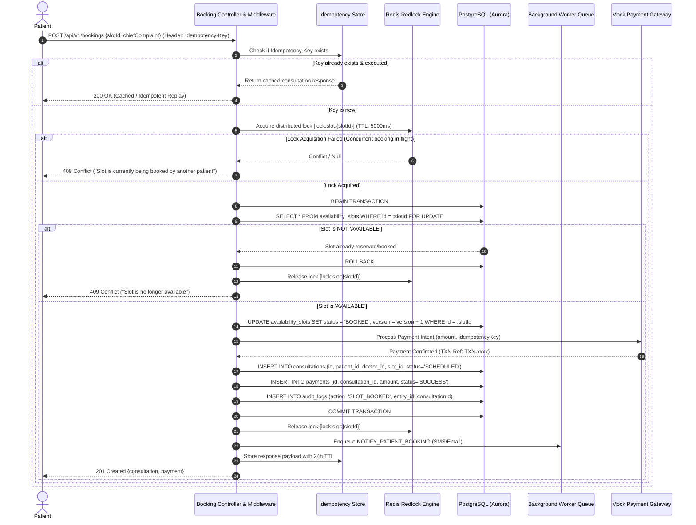
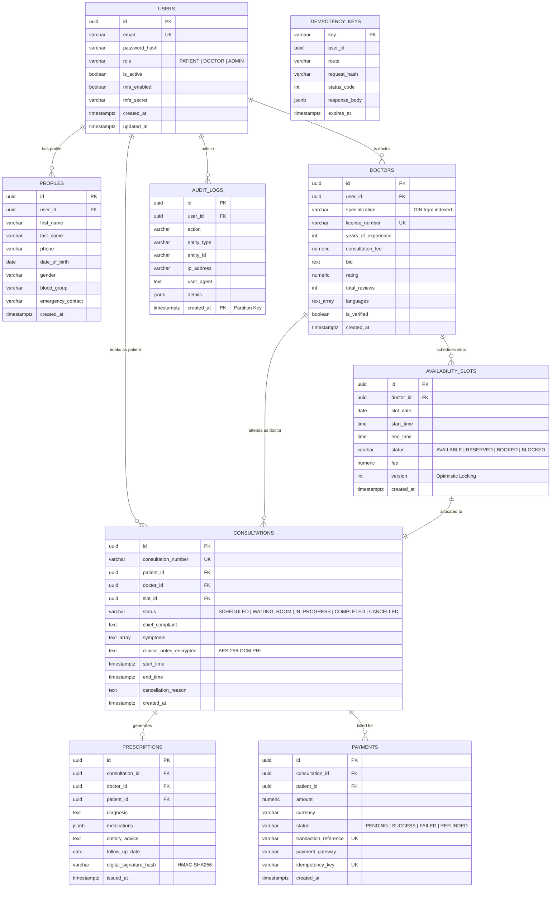

# Amrutam Telemedicine Backend: Architecture & System Design Document

**Target Capacity:** 100,000 daily consultations  
**Throughput:** Peak 500 writes/sec, 5,000 read QPS  
**Latency Objectives:** p95 < 200ms reads, p95 < 500ms writes  
**Availability SLA:** 99.95% (~4.38 hours allowed annual downtime)  
**Compliance Standards:** DISHA (Digital Information Security in Healthcare Act), HIPAA, ISO 27001  

---

## 1. High-Level Architecture & Data Flow

Amrutam’s telemedicine system is engineered as a cloud-native, modular service architecture structured around **Domain-Driven Design (DDD)** and **Hexagonal (Ports and Adapters)** principles. 



### Data Flow Execution:
1. **Client Request:** Mobile/Web client sends encrypted HTTPS requests with JWT Bearer Token, optional `Idempotency-Key`, and W3C `traceparent` headers.
2. **Edge Security:** Cloudflare mitigates L3/L4/L7 DDoS attacks, enforces Web Application Firewall (OWASP Top 10 rules), and caches static assets.
3. **Ingress & Routing:** Nginx Ingress routes traffic into the EKS private subnet cluster.
4. **Middleware Pipeline:**
   - Observability: Generates correlation `X-Request-Id` and records request duration in Prometheus histograms.
   - Rate Limiter: Token-bucket per IP/User to prevent brute-force attacks.
   - Authentication & MFA: Validates JWT access tokens and RFC 6238 TOTP requirements.
   - Idempotency Gate: Intercepts POST/PUT requests; if an `Idempotency-Key` has already been processed, returns the cached result without duplicate execution.
   - RBAC Guard: Restricts actions by role (`PATIENT`, `DOCTOR`, `ADMIN`).
5. **Data Layer Access:** Application services execute business operations using read-replica routing for searches and primary cluster transactions for state mutations.
6. **Async Offload:** Heavy tasks (prescription PDF compilation, SMS/email dispatches, refund processing) are queued for async execution.

---

## 2. Booking Flow Sequence Diagram

Booking an appointment slot in a telemedicine system with 100k daily consultations requires strict concurrency control to prevent double-booking race conditions while maintaining sub-500ms write latency.



---

## 3. Entity-Relationship (ER) Diagram

The data model is normalized to 3NF with strategic indexing and partitioning to guarantee sub-millisecond lookups under multi-million row scale.



---

## 4. API Schema & Versioning

- **Format:** OpenAPI 3.0 / 3.1 & RESTful standard.
- **Prefix:** `/api/v1` for future-proof API contract evolution.
- **Documentation:** Interactive Swagger UI mounted live at `/api-docs` and exportable via `/api-docs.json`.
- **Response Standard:**
  ```json
  {
    "success": true,
    "message": "Operation completed successfully",
    "data": { ... }
  }
  ```
- **Error Standard:**
  ```json
  {
    "success": false,
    "error": {
      "code": "VALIDATION_ERROR",
      "message": "Detailed error summary",
      "details": []
    }
  }
  ```

---

## 5. Retry & Backoff Strategies

In a distributed healthcare platform processing 100k consultations daily, third-party network blips (SMS gateways, payment webhooks, database connection timeouts) are inevitable.

### Algorithms Implemented:
1. **Exponential Backoff with Full Jitter:**
   $$\text{Delay}(attempt) = \text{random}(0, \min(M, B \times 2^{attempt}))$$
   - Prevents the **Thundering Herd** problem where thousands of retrying nodes overwhelm an already recovering database or downstream service.
   - Base backoff ($B$): 500ms; Max backoff ($M$): 10,000ms.
2. **Circuit Breaker Pattern:**
   - Threshold: 50% failure rate over a 10-second rolling window.
   - State: Moves from `CLOSED` -> `OPEN` (tripped). In `OPEN` state, requests fail-fast immediately without taxing downstream resources.
   - After a 30-second cooldown, moves to `HALF-OPEN` to test connectivity with canary traffic.
3. **Dead Letter Queue (DLQ):**
   - After 3 exhausted retries, background jobs are automatically shifted to `deadLetterQueue` with detailed failure stack traces and context payloads.
   - Operations teams receive real-time alerting via Slack/PagerDuty to inspect and replay jobs via the Admin CLI.

---

## 6. Data Partitioning Strategy

100,000 daily consultations generate:
- 100k `consultations` rows / day ($\approx 36.5$ million / year)
- 100k `prescriptions` rows / day
- 100k `payments` rows / day
- 800k - 1.2M `audit_logs` rows / day ($\approx 350$ million / year)

### PostgreSQL Declarative Range Partitioning:
1. **`audit_logs` Table:**
   - Partitioned by `RANGE (created_at)`.
   - Dedicated quarterly tables: `audit_logs_2026_q1`, `audit_logs_2026_q2`, etc.
   - Enables instantaneous dropping or archival of regulatory logs past retention boundaries without table locks (`DETACH PARTITION`).
2. **`consultations` Table:**
   - Partitioned by `RANGE (created_at)` on yearly boundaries.
   - High-velocity active queries (past 90 days) hit hot in-memory partitions.
3. **Horizontal Sharding (Future Scale > 1M daily):**
   - Key: Hash of `patient_id` or geographical tenant ID (`region_code: IN-NORTH`, `IN-SOUTH`, `IN-WEST`).
   - Uses Citus Data or Aurora Multi-Master for seamless scale-out across physical shards.

---

## 7. Caching & Concurrency Handling

### Two-Tier Caching Architecture:
1. **L1 In-Memory LRU Cache:**
   - Stored in Node.js process memory.
   - Caches immutable reference data (system configs, doctor specialization taxonomy, translations).
   - TTL: 60 minutes.
2. **L2 Distributed Redis Cluster:**
   - **Cache-Aside Pattern:** Doctor profiles, slot availability listings, patient dashboard summaries.
   - Read latency: p95 < 15ms.
   - **Write-Through / Cache-Invalidation:** Whenever doctor modifies schedules or slot is booked, key pattern `slots:{doctorId}:*` is invalidated immediately.

### Concurrency & Double-Booking Elimination:
- **Distributed Lock (Redlock Pattern):**
  - Lock Key: `lock:slot:{slotId}`.
  - Acquisition uses atomic `SET NX PX` with a 5000ms expiration.
  - Lua scripts ensure safe atomic release matching token ownership.
- **Pessimistic Row-Level Lock (`SELECT ... FOR UPDATE`):**
  - Within database transactions, the slot row is locked at the PostgreSQL storage engine level, preventing any other transaction from reading or modifying the status simultaneously.
- **Optimistic Concurrency Control:**
  - Table `availability_slots` includes a `version INT DEFAULT 1` column.
  - Write query: `UPDATE availability_slots SET status = 'BOOKED', version = version + 1 WHERE id = :id AND version = :currentVersion`.

---

## 8. Transaction Management & Sagas

When a consultation is booked or cancelled, multiple distributed systems must coordinate: Slot Allocation, Payment Gateway, Notification Dispatch, and Audit Logging.

### Distributed Saga Pattern (Orchestrator):
1. **Booking Saga:**
   - *Step 1 (Local Tx):* Reserve slot status (`RESERVED`).
   - *Step 2 (Gateway Tx):* Execute payment charge.
   - *Step 3 (Local Tx):* Transition slot to `BOOKED`, create `consultation`, record `audit_log`.
   - *Step 4 (Async):* Dispatch confirmation notification.
2. **Compensating Transactions (Rollback):**
   - If payment gateway declines or times out: Compensating transaction releases slot back to `AVAILABLE`.
   - If consultation is cancelled by patient/doctor: Compensating refund saga invokes `paymentService.refundPayment()`, sets payment to `REFUNDED`, releases slot, and triggers async refund webhook.

---

## 9. Backup & Disaster Recovery (DR) Strategy

Healthcare records require zero data loss and uninterrupted availability.

| Metric | Target | Implementation |
|---|---|---|
| **RPO (Recovery Point Objective)** | **< 15 minutes** | Continuous AWS Aurora WAL log archiving to S3 + continuous snapshots |
| **RTO (Recovery Time Objective)** | **< 60 minutes** | Automated Terraform infrastructure reconstitution in secondary region (`ap-south-2` Hyderabad) |
| **Availability SLA** | **99.95%** | Multi-AZ deployment across 3 availability zones with automated failover |

### DR Runbook Highlights:
1. **Continuous Backups:** Automated daily snapshots retained for 35 days, encrypted with customer-managed AWS KMS keys.
2. **Cross-Region Replication:** Asynchronous Aurora storage-level replication to secondary disaster-recovery AWS region.
3. **Disaster Simulation (Chaos Engineering):** Quarterly automated chaos testing simulating primary AZ database failure and verifying that replica promotion occurs in under 30 seconds with zero data loss.
